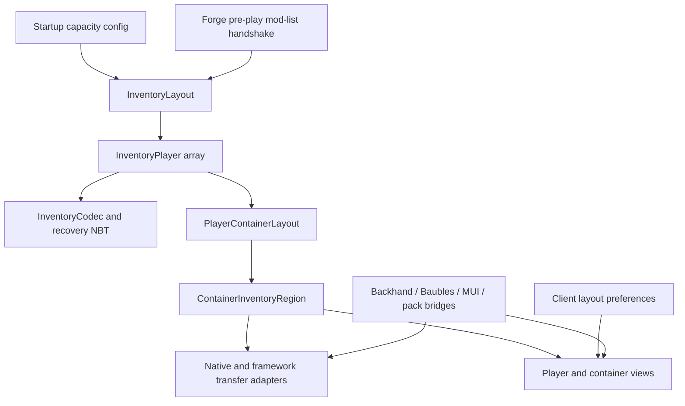

# Dynamic Inventory architecture (0.8.0)

For GTNH 2.9.1, see the [v0.8.3 architecture and development priorities](architecture-0.8.3.md). This document records the earlier 0.8.0 design and its qualification history.

This document describes the current 0.8 inventory core, public native/MUI2 UI APIs, and their qualified boundaries. Inventory state remains independent of UI framework choice, native player/container screens remain the default, and the MUI2 presentation overlay remains optional. API version 1 is experimental in this unreleased build; the source-integrated results below apply only to the named fixtures and standard builder paths, not every MUI2 inventory or the full pack. The new [live resizing transaction](live-inventory-resizing.md) adds per-player immutable capacity snapshots, persisted overrides, and a persistent-container synchronization gate; its qualification is separate from older fixed-capacity results below.

## System boundaries

Dynamic Inventory separates inventory state from its presentation. The server owns the inventory array, container slots, transfers, and persisted item state. The client may choose a different grid arrangement, visible row count, machine viewport mode, or panel shape, but those preferences do not change capacity or slot identity.

The main implementation areas are:

| Area | Responsibility |
| --- | --- |
| `inventory/` | Effective capacity and raw/logical index translation |
| `persistence/` | Legacy save compatibility, extra-slot persistence, and recovery records |
| `container/` | Stable player-container IDs, canonical slot discovery, and transfer helpers |
| `mixins/` | Targeted hooks into vanilla and supported mod containers, player data, public UI API lifecycle, and framework builders |
| `api/` | Experimental version-1 native registration, presentation/layout and transfer contracts, live MUI2 player widget factory, and binding views |
| `compat/` | Optional API bridges, shared built-in native adapter registration, and conditional mixin selection |
| `client/` | Player layout, native GUI decoration, preferences, viewport fitting, and theme loading |

Mixin sources are grouped by integration: `minecraft`, `forge`, `bogosorter`,
`craftingtweaks`, `etfuturum`, `galacticraft`, `modularui`, `modularui2`, `nei`,
`openblocks`, and `tconstruct`. Minecraft hooks shared by all adapters live in
`minecraft`; NEI-dependent Minecraft hooks live in `nei`. `EarlyMixinsLoader`
keeps its existing bootstrap path. Both loaders use package-relative class names
and retain the existing mod-presence and client/server guards.

## Capacity and slot identity

`InventoryCapacity` loads the server's `capacity.storageSlots` default once at startup. The supported range is 27–216 **storage** slots; the hotbar is always nine more. The default is 72 storage plus nine hotbar slots, for 81 ordinary player slots. Changing that server-wide default requires a restart; the experimental `/dinvsize` transaction can change a player's saved override during play. Runtime code reads `InventoryLayout.of(player.inventory)` for the player's immutable shape, rather than the process-wide default. Configuration is `config/dynamicinventory.cfg`; client-only presentation preferences use `config/dynamicinventory-client.cfg`.

`InventoryLayout` distinguishes logical ordinary indices from raw `InventoryPlayer.mainInventory` indices. Ordinary logical indices 0–8 are the hotbar, 9–35 are the legacy 27 storage slots, and 36 onward are added storage. Without Backhand, ordinary and raw indices coincide. In the Backhand compatibility profiles, raw index 36 stays reserved for the offhand and logical indices 36 onward map one slot later. This keeps the mod's added storage from taking over Backhand's offhand.

The 1.7.10 player container preserves existing IDs: crafting/result and armor retain their native positions, storage IDs 9–35 remain, and hotbar IDs 36–44 remain unchanged. Backhand retains container ID 45 when enabled. `ContainerPlayerMixin` appends only the added ordinary slots after this established range. `PlayerContainerLayout` is the authoritative conversion between logical indices and container IDs; adapters should not infer the player region from a fixed machine-slot boundary.

The Backhand raw array index and the container slot ID are separate namespaces: Backhand reserves raw `mainInventory[36]`, while the corresponding offhand `Slot` has container ID 45. Container IDs 36–44 are the nine hotbar slots. Without Backhand, logical ordinary storage index 36 maps to raw index 36 and container ID 45. With Backhand, that same logical slot maps to raw index 37 and container ID 46, after the offhand.

The ordinary slot order and the visible grid are independent. `InventoryViewSettings` saves the player's preferred columns/rows, machine vertical-versus-scroll choice, and native-panel full-box-versus-compact choice. The player grid can display 3–18 columns and a capacity/window-limited number of rows. Machine viewport settings affect standard MUI1/MUI2 machine panels only; panel shape does not change capacity. All are client-side preferences.

The current player GUI is `PlayerInventoryScreen`, a custom `GuiContainer` view over the existing player container. `InventoryViewLayout` computes grid dimensions, visible rows, and scrolling; `PlayerHeaderLayout` places crafting, armor, the player preview, optional Backhand, and equipment controls. The grid icon opens a client settings dialog. Native inventory tabs and supported Baubles controls are inserted through client compatibility helpers. Changing the grid repositions slots and preserves third-party buttons where possible; it does not rebuild the authoritative server inventory.

## Startup negotiation and persistence

The early mixin loader registers capacity and inventory hooks before `InventoryPlayer` construction. For Forge's pre-play `ModList`, `CapacityHandshakeMixin` advertises the mod version with a storage-capacity suffix. `DynamicInventory.acceptsRemote` validates the mod/build and relevant Backhand/pack compatibility. `CapacityLoginMixin` targets the handshake check that receives the actual `ModList`; after Forge accepts the remote mod list, a client adopts the server's advertised capacity before entering play. Invalid or missing startup-capacity data is rejected. The server restores its configured local capacity before it starts hosting.

`InventoryPlayerMixin` copies the vanilla array to the effective raw length while leaving vanilla array-based lookup, pickup, use, and ticking behavior intact. It also delegates save/load/copy operations to `InventoryCodec`. The codec writes the vanilla 36-slot portion in the legacy list format. Added slots are stored under the player NBT `dynamicinventory` compound with a schema version, recorded main-slot count, and `extraItems` list. Recovery NBT retains malformed, unsupported, or out-of-capacity entries instead of silently dropping them. When capacity shrinks, occupied added slots are quarantined with their original logical index; a later load with enough capacity can restore them into vacant original positions. Existing items are not overwritten.

The effective capacity is shared by server containers and client views. A client-side grid preference, a GUI-scale change, or a resource pack cannot resize the array, rewrite saved slot identities, or change synchronization. The core, shrink/regrowth, dedicated-server, and real startup-capacity evidence is recorded under [`qualification/startup-capacity/`](qualification/startup-capacity/); each report states the artifact checksum it exercised.

## Container and transfer integration

`ContainerInventoryRegion` scans a native container for slots backed by the player's actual `InventoryPlayer`, then maps their raw indices to logical ordinary indices. It validates the legacy player slots and appends missing added-storage slots at the end, preserving native machine, crafting, equipment, and attached-chest IDs. `ContainerRegionMixin` intercepts `Container.mergeItemStack` only when the original range is a complete player storage, hotbar, or combined player region. Machine ranges and partial ranges remain native.

`PlayerInventoryTransfers` implements the shared merge/shift-transfer behavior across those logical regions. It merges compatible stacks before filling empty slots and respects item validity and slot limits. Where the game or a mod has special source branches or hardcoded 36-slot assumptions, a family-specific mixin delegates only the added-slot case and keeps native machine filters and callbacks intact. Examples include player-container shifts, furnace destinations, Tinkers crafting/chest movement, and optional NEI/BogoSorter hooks.

Native adapters use the same explicit `InventoryUi` registration contract for built-in and external integrations. `BuiltinInventoryUiAdapters` registers exact vanilla chest, workbench, and furnace classes; the pinned compatibility profile additionally registers exact Tinkers Crafting Station and Galacticraft classes. Family transfer policies preserve furnace filters and native transfer semantics. Unknown classes remain unmodified unless separately registered; a registration or candidate scan never enables a wildcard.

`NativeInventoryPanel` decorates the existing `GuiContainer` rather than replacing its class or container. It finds the player region from the canonical container adapter, moves native/player slot coordinates, relocates known header anchors, and draws the expanded region using the vanilla slot atlas. The native GUI continues to own its title, machine controls, recipe widgets, tabs, and packets. The panel's `Machines: Vertical`/`Machines: Scroll` preference applies to MUI machine viewports; `Containers: Full box`/`Containers: Compact` controls the decorated native panel silhouette. The Tinkers adapter additionally handles cached header/chest geometry, clips obsolete fixed-grid background art, budgets vertical space before native compressed-chest layout selection, and restores/re-captures native chest-slot positions around drawing.

## MUI1 and MUI2

Both frameworks receive a logical ordinary-player inventory wrapper that preserves the framework's native player-wrapper type for its transfer classification. The wrapper exposes all effective ordinary slots and delegates reads, writes, insertion, extraction, limits, and validity checks to the canonical player wrapper after translating around Backhand's raw offhand index. These live-slot and binding paths are separate from the optional native-GUI presentation overlay below.

The MUI1 player-group builder creates nine hotbar widgets and a nine-column scrollable storage area. `InventoryViewport` keeps the framework's rebuild callback so enabled-slot state is synchronized after a scale/resize rebuild. A transfer redirect preserves access to offscreen player slots for shift-clicks; viewport clipping must not make those items unavailable. The resize mixin changes the MUI1 window and player group based on available scaled height.

The public `Mui2InventoryWidgets.playerInventory(...)` factory produces a live nine-column hotbar plus storage viewport as MUI2 `SlotGroupWidget`/`ItemSlot` children. The normal `sync.bindPlayerInventory(player)` builder path registers all logical slots through the shared canonical expanded-player wrapper; the standard MUI2 `SlotGroupWidget.playerInventory` factory and matching binding are intercepted centrally. New panels using those standard entry points need no custom container override merely to expose expanded player slots. The fixed-columns/visible-rows overload leaves resize geometry to the caller. `InventoryScrollWidget` participates in hit testing; `ResponsiveInventoryPanel` adjusts only the standard player viewport and its ancestor heights; machine controls retain native dimensions. A resize re-enters MUI2 layout after dimension update. `Machines: Scroll` caps visible machine rows at three; `Machines: Vertical` uses available height and falls back when necessary.

These are client UI-builder and binding adaptations, not alternate inventory stores or custom wire protocols. The server-side container and synchronized logical slots remain authoritative. Coverage is limited to the standard MUI1 and MUI2 builders, listed source fixtures, and viewport tests. Bespoke MUI2 bindings, custom widget trees, overridden quick-move/transfer dispatch, or other per-screen protocols require separate review and qualification. No count from the class scanner below is a count of supported GUIs.

## Compatibility bridges and resource theme

| Bridge | Current role and boundary |
| --- | --- |
| Backhand | Enabled only for the separate `rc2-backhand` and `rc2-integration` development profiles with Backhand 1.8.16. Raw slot 36 remains offhand; a small pickup hook handles free ordinary slots if Backhand's offhand rule short-circuits vanilla's empty-slot search. |
| Baubles Expanded | `BaublesInventoryBridge` creates native `SlotBauble` slots backed by the player's current Baubles inventory. Slots bind through the native player handler after player construction/login; no duplicate equipment inventory or custom save format is introduced. Inline/side-panel layout and synchronization blocking are client integration behavior. |
| BogoSorter | Conditional slot/refill hooks apply only in the RC-2 integration profile. They translate its player ranges and preserve the native source slots. |
| NEI | Conditional crafting-container hooks adapt recipe transfer and ghost positioning. NEI's own transformer hook is only loaded when its core plugin exists. |
| Galacticraft and Tinkers | Conditional RC-2 adapters extend their actual native containers and preserve native equipment, chest, recipe, and transfer behavior around the appended player region. |
| MUI1 / MUI2 | Framework wrappers and builder/binding hooks are loaded only when that framework is present; both are independently qualified in the integration fixtures. |

The MUI2 answer is therefore scoped: **not every existing MUI2 inventory is verified**. Screens using the standard MUI2 `bindPlayerInventory` plus standard `SlotGroupWidget.playerInventory` path receive the canonical expanded player binding through shared hooks. Custom slot factories, bindings, container overrides, or quick-move/transfer behavior can bypass that path and need an audit and focused qualification.

`InventoryGuiTheme` reads the optional `dynamicinventory:inventory_theme.json` from the active resource manager and reloads it when resource packs reload. Schema 1 supplies an alpha-first ARGB palette for frame edges, preview, controls, labels, and scrollbars. Missing or invalid files/colors fall back to the built-in vanilla palette. Transparent panel centers reveal the world; regular slot artwork continues to use the active pack's vanilla inventory atlas. The separately maintained [Glass UI fork](glass-ui-integration.md) changes colors only; it does not supply a new inventory backing store or change capacity.

## Qualification and pinned environment

The installed full-pack target is GTNH `2.9.0-RC-2`; its archive SHA-256 is `0C7DA79F4AC1982C8A7DBFDCC1F1AF6CF96AC5CB345A1C3387FB090D974B0A8D`. The archive and relevant installed file hashes are captured in [`pack-compatibility-rc2.json`](../pack-compatibility-rc2.json). Pins that matter to the described optional adapters include Backhand 1.8.16, Baubles Expanded 2.2.25-GTNH, BogoSorter 1.3.54-GTNH, GT 5.09.54.205, ModularUI 1.3.4, MUI2 2.3.92-1.7.10, NEI 2.8.155-GTNH, Tinkers Construct 1.14.118-GTNH, and Galacticraft 3.4.34-GTNH. These identify the captured test baseline, not a promise that all versions or all screens are compatible. The MUI2 version is pinned from the installed RC-2 file manifest and SHA-256, not inferred from a Git commit; the local `.setup/research/ModularUI2` source snapshot has no Git metadata.

Evidence is split by scope so an isolated test does not masquerade as full-pack acceptance:

- [`qualification/startup-capacity/`](qualification/startup-capacity/) records real startup-capacity matrices, saved-item shrink/regrowth, dedicated-server checks, and machine modes with artifact hashes.
- [`qualification/glass-ui/merged-frame-regression/`](qualification/glass-ui/merged-frame-regression/verification.json) records the 108-check RC-2 native-container regression across ten real chest, crafting, furnace, Tinkers, Galacticraft, and GT interfaces against its recorded 0.8.0-dev artifact.
- [`qualification/glass-ui/container-frames/`](qualification/glass-ui/container-frames/verification.json) records 172 full-pack frame/layout checks covering chest, Galacticraft tab, and a Tinkers compressed chest in Full box and Compact modes, across GUI scales 1, 2, 3, and Auto, with inventory/cursor preservation and chest interactions.
- [`qualification/glass-ui/integrated-modes/`](qualification/glass-ui/integrated-modes/verification.json) records 44 stock MUI1/MUI2 builder checks; [`full-pack-modes/`](qualification/glass-ui/full-pack-modes/verification.json) records 24 checks on a real GT buffer. Read the hashes in each report: those earlier artifacts are not silently rebased onto the latest jar.
- [`qualification/container-adapters/`](qualification/container-adapters/) and [`qualification/backhand/`](qualification/backhand/) hold isolated server assertions and input/transfer, ticking, death/respawn, and Backhand checks. They test targeted behavior and do not imply universal mod compatibility.

### Current UI API qualification coverage

The table combines source-integrated fixtures, dedicated-server tests, and selected full-pack runtime suites. All listed runtime reports record artifact SHA-256 `80D8F5F078E669433ED7952115DC2AF6D2605732F3DC3ED13FE20E1C7DE164A1`; each report remains authoritative for its own profile and exact scope.

| Area | Evidence | Scope |
| --- | --- | --- |
| Public native API and built-in registry | [34 client checks and 53 server checks](qualification/ui-api/integrated/verification.json); [test script](../scripts/testing/test-ui-api.ps1) | Registered native, filtered native, actual input/transfer roundtrips, unknown subclass remains untouched, audit path; source-integrated fixture only |
| Shared MUI2 binding and public factory | [40 client checks](qualification/ui-api/mui2-integrated/verification.json), [285 factory/server assertions](qualification/ui-api/mui2-integrated/selftest-server.json); [test script](../scripts/testing/test-mui2-api.ps1) | Standard binding and responsive/fixed factory paths, source-integrated fixture only |
| Common containers and vanilla assertions | [74 regression checks and 346 vanilla assertions](qualification/ui-api/container-regression/verification.json) | Vanilla chest/double chest/workbench/furnace and stock MUI1/MUI2 public bindings; full-pack adapters explicitly require separate qualification |
| Machine viewport modes | [44 checks](qualification/ui-api/machine-modes/verification.json); [test script](../scripts/testing/test-machine-modes.ps1) | Standard MUI1/MUI2 viewports and player-content conservation; report states whether full-pack testing was used |
| Optional native MUI2 presentation | [115 checks](qualification/ui-api/native-presentation/verification.json); [test script](../scripts/testing/test-mui2-presentation.ps1) | Source-integrated player screen and native chest only; this is frames/slot backgrounds with native item/input ownership |
| Public example compilation | [Java 8 examples report](qualification/ui-api/examples-verification.json), [test script](../scripts/tools/Test-InventoryUiExamples.ps1) | Native and MUI2 examples compile against public API/fixture classpath with no internal imports |
| Discovery tooling | [scanner summary](qualification/ui-api/discovery-summary.json), [generator checks](qualification/ui-api/tooling.json) | Static structural leads and synthetic generator validation; not compatibility qualification or supported-GUI counts |
| Dedicated native API | [34 client + 54 server checks](qualification/ui-api/dedicated/verification.json) | Dedicated-server registration, binding, and sync behavior |
| Dedicated MUI2 API | [40 client + 285 factory/server assertions](qualification/ui-api/mui2-dedicated/verification.json) | Dedicated-server path plus standard MUI2 binding/factory checks |
| Startup capacity matrix | [15 checks over five cold boots](qualification/ui-api/capacity-matrix/verification.json) | Startup capacities 72, 27, 73, 216, and 72 storage slots |
| Isolated profile without MUI | [8 checks](qualification/ui-api/isolated/verification.json) | Native inventory behavior with no MUI framework present |
| Full-pack native containers | [108 checks](qualification/ui-api/full-pack-containers/verification.json) | Ten actual RC-2 container families and interaction/transfer coverage |
| Full-pack native frames | [184 checks](qualification/ui-api/full-pack-frames/verification.json) | Chest, Galacticraft, and compressed Tinkers chest layouts at tested scales/modes |
| Full-pack GT MUI2 buffer | [13 checks](qualification/ui-api/gt-mui2/verification.json) | One actual GT buffer: stock binding, click/scroll, audit/scaffold, and exact inventory conservation |
| Full-pack machine modes | [24 checks](qualification/ui-api/full-pack-modes/verification.json) | One actual GT buffer in Scroll and Vertical modes, including short-window scrolling |
| Full-pack MUI2 presentation | [115 checks](qualification/ui-api/full-pack-presentation/verification.json) | Opt-in frame/slot-background presentation for the player screen and native chest; item rendering/input remain native |

Dedicated-server, capacity-matrix, isolated-profile, listed full-pack native suites, and the three named full-pack MUI2 scopes are complete. These MUI2 results cover one GT buffer and two presentation screens; they do not establish compatibility for every MUI2 machine or custom GUI. The small fixture profiles use disposable worlds, configured local ports, and test-only command classes. The RC-2 compatibility mode validates selected versions before enabling optional integrations. See [container integration](container-integration.md), [startup capacity](startup-capacity.md), and the individual reports for exact scope and artifact checksums.

## MUI2 presentation and migration boundary

The player menu is still `PlayerInventoryScreen`; native chest, furnace, crafting, Galacticraft, Tinkers, and machine GUIs retain their native classes and interaction code. There is now an optional MUI2 presentation backend, `InventoryPresentation` / `NativeInventoryPresentation`, that paints panel frames and slot-background widgets through private MUI2 `ModularPanel`/`ModularScreen` widget trees during the owning GUI's background pass. It does not create MUI2 `ItemSlot` widgets, register these scenes with MUI2's global overlay/input stack, or take ownership of item rendering and input. Native slots continue to render the actual items and handle hit testing, pickup/place, container synchronization, and transfers.

The option is exposed in the layout dialog as **Presentation: MUI2 (test)** / **Presentation: Native**, button ID 112, and persists as `B:mui2Presentation=false` by default in `config/dynamicinventory-client.cfg`. It can only be enabled when MUI2 is loaded. This is an opt-in presentation mode, not a replacement player screen or full-pack GUI migration. Source-fixture evidence is recorded under [`qualification/mui2-presentation/source-fixture/`](qualification/mui2-presentation/source-fixture/); the separate [115-check RC-2 report](qualification/ui-api/full-pack-presentation/verification.json) covers the player screen and a native chest at scales 1, 2, 3, and Auto, including native mouse round trips and preservation. Both retain the canonical native container and native item/input ownership. The source harness reports 112 rendered slot-background widgets and 21 Baubles slots in its tested player screen.

**Recommendation:** keep the inventory core, save schema, container IDs, and server protocol independent of MUI2. Retain native GUIs as the default, and keep MUI2 presentation opt-in. Do not infer from the current prototype or from MUI2 machine builders that the entire full-pack GUI set should be rewritten. The original `NativeInventoryPanel` remains the default renderer and compatibility path.

The optional presentation overlay uses native slots and deliberately adds only frames and slot backgrounds. It is distinct from the qualified standard MUI2 live-player-slot builder path described above; do not overlay MUI2 `ItemSlot` widgets on a native container's slots. A full-pack-wide conversion of existing native screens would be a separate project: it would need per-family GUI pairing, custom binding and transfer handling, preserved recipe/equipment behavior, and its own qualification.

If the user later chooses to continue beyond this presentation experiment, use this sequence:

1. **Keep the presentation setting opt-in.** Its 115-check RC-2 report covers the player screen and native chest. The full-pack GT buffer reports qualify the named stock binding and machine modes only.
2. **Keep the standard MUI2 player binding and widget factory narrowly scoped.** Custom GUI bindings, widgets, quick-move dispatch, recipe/equipment rules, and screen/container pairing require explicit review and additional qualification.
3. **Only consider a broader MUI2 screen migration as a separate project.** Test each family’s crafting, armor, hotbar, every storage slot, optional offhand/equipment, mouse pickup/place, drag/split, number-key swaps, creative behavior, scrolling, and close/reopen state. Preserve native recipes, filters, tabs, sorting, and server-authoritative containers; keep unported families on their existing path.
4. **Expand qualification before changing any default.** Run source fixture, pinned RC-2 integration, dedicated-server, and full-pack suites. Check exact item/cursor conservation, synchronization, GUI bounds, screenshots, scroll reachability, resource reload/fallback, and the artifact SHA.

This recommendation lets the MUI2 widget presentation evolve independently while the tested inventory array, save schema, container identities, and server authority remain stable.
